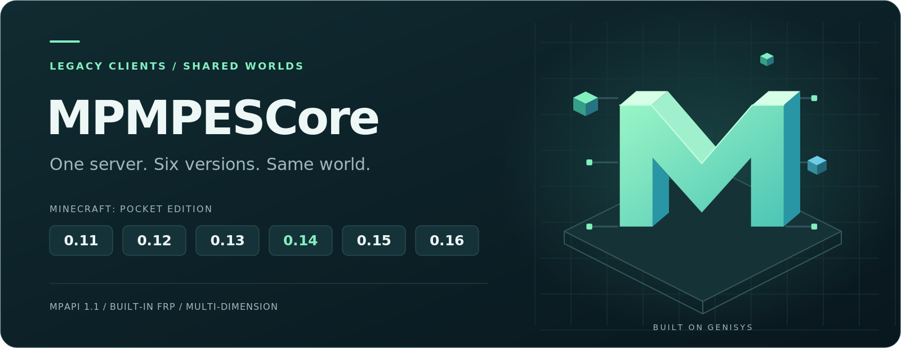
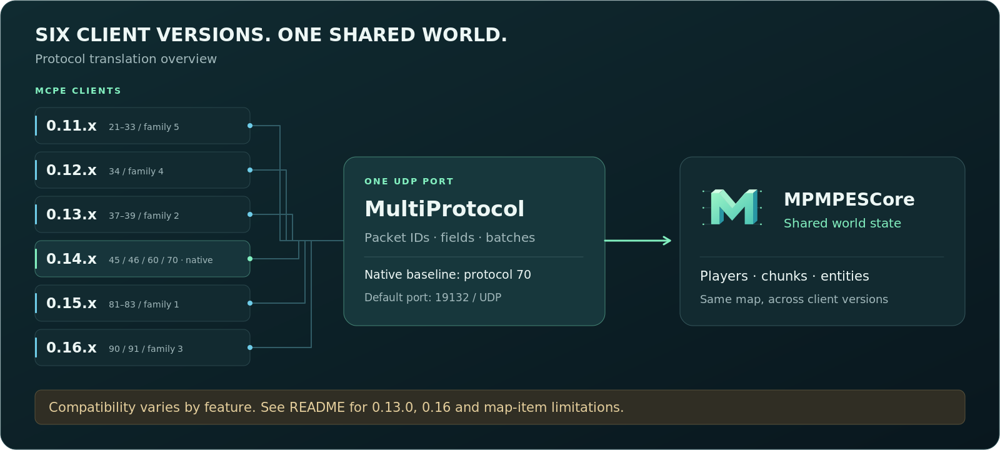
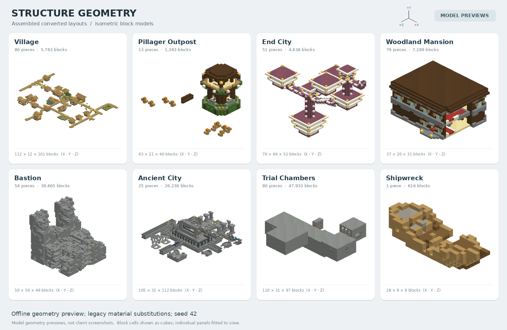

<p align="center">
  
</p>

<h1 align="center">MPMPESCore</h1>

<p align="center"><strong>六个版本，同一片方块世界。</strong></p>

<p align="center">
  面向 MCPE 0.11–0.16 的跨版本服务端核心，基于 Genisys 构建。<br>
  核心 1.1 · MPApi 1.1 · PHP 8.4 ZTS · LGPL-3.0-or-later
</p>

<p align="center">
  <a href="#快速启动">快速启动</a> ·
  <a href="#客户端兼容性">客户端兼容性</a> ·
  <a href="#核心功能">核心功能</a> ·
  <a href="#文档导航">文档导航</a> ·
  <a href="https://github.com/mpmp666/MPMPESCore/issues">反馈问题</a>
</p>



**MPMPESCore** 由 mpmpes 基于 [Genisys](https://github.com/iTXTech/Genisys) 修改构建，让不同版本的 MCPE 客户端通过**同一个端口、同一张地图**联机。项目同时提供多维度生成、建筑模板适配、生物 AI 与附魔改进、MPApi 插件接口及内置 frp 客户端。

> **适用范围：**本项目面向旧版 MCPE 客户端；“26.2 参考适配”指部分建筑、末地生成、生物行为与附魔规则的移植，不表示支持现代客户端，也不等同于完整 Java 26.2 服务端。逐版本兼容性和已知问题见下表。

## 客户端兼容性

| 客户端 | 协议号 | 接入方式 | 使用提示 |
| --- | --- | --- | --- |
| **MCPE 0.11.x** | 21–33；正式版实测为 27 | family 5 翻译层 | 登录、地形已真机验证；模式切换与创造栏按参考端修复，仍需持续验证 |
| **MCPE 0.12.x** | 34 | family 4 翻译层 | 已有真机接入验证；使用独立创造栏白名单 |
| **MCPE 0.13.x** | 37 / 38 / 39 | family 2 翻译层 | 建议使用 **0.13.1 / 0.13.2**；0.13.0 登录包缺字段，可能被判为无效皮肤 |
| **MCPE 0.14.x** | 45 / 46 / 60 / 70 | 原生协议 | 服务端基准协议为 **70** |
| **MCPE 0.15.x** | 81 / 82 / 83 | family 1 翻译层 | 封包 ID、字段布局与 RakNet 封装适配 |
| **MCPE 0.16.x** | 90 / 91 | family 3 翻译层 | 已可接入；保留以下已知限制 |



**部署前请了解这些已知问题：**

- **0.16 氧气条：**生存模式在陆地上仍会显示气泡条。
- **0.16 斜杠指令：**部分指令会被客户端本地校验拦截，回显“用法”而不向服务端发包。
- **0.16 地图数据：**暂不支持地图物品数据包，MPApi 地图功能对该版本不发送数据。
- **填充地图崩溃：**项目已有记录显示，玩家手持 Filled Map 会导致客户端崩溃，局域网与 frp 均可复现，根因尚未定位。使用地图媒体 API 前应先在测试环境验证。

协议细节、各版本修复范围与问题追踪见 [功能与协议技术说明](docs/TECHNICAL_NOTES.md)。表中的真机验证范围沿用项目已有记录，不代表逐版本、逐功能的完整验收。

## 快速启动

### 1. 准备运行环境

项目已验证的环境为 **64 位 PHP 8.4 CLI + ZTS（线程安全）+ pmmpthread 6.x**，同时需要以下扩展：

```text
sockets · curl · yaml · sqlite3 · zlib
```

PHP 二进制可从 [pmmp/PHP-Binaries](https://github.com/pmmp/PHP-Binaries) 选择匹配的构建，确认其包含所需扩展。`bin/` **不随源码分发**，需要自行配置；目录名中的 `php7` 是沿用的启动脚本路径，不表示使用 PHP 7。

| 平台 | 启动脚本默认查找的 PHP 路径 |
| --- | --- |
| Linux / macOS | `bin/php7/bin/php` |
| Windows | `bin/php/php.exe` |

### 2. 获取源码并启动

```bash
git clone https://github.com/mpmp666/MPMPESCore.git
cd MPMPESCore

# 先将匹配的 PHP 运行时放入 bin/，再启动
./start.sh
```

Windows 配置好 PHP 后运行 `start.cmd`。也可以在项目根目录直接启动源码入口：

```bash
# Linux / macOS
./bin/php7/bin/php ./src/pocketmine/PocketMine.php
```

```powershell
# Windows
bin\php\php.exe -c bin\php src\pocketmine\PocketMine.php
```

### 3. 配置并连接

首次运行会生成 `server.properties`、`pocketmine.yml` 和 `genisys.yml`。按需修改后重启，在客户端添加服务器地址及端口；默认游戏端口是 **UDP 19132**，公网直连时需放行对应 UDP 端口。

| 文件 | 主要用途 |
| --- | --- |
| `server.properties` | 服务器名称、端口、人数、游戏模式、主世界等 |
| `pocketmine.yml` | PocketMine 基础配置 |
| `genisys.yml` | 维度、建筑、AI 与附魔相关设置，以及核心增强功能 |
| `frp.toml` / `frp_<名字>.toml` | 可选的内置 frp 隧道配置，需要可连接的 frps 服务端 |

> **更新已有服务器：**先备份配置、世界、玩家数据和插件。运行时配置与存档不在 Git 跟踪范围内；新建筑只出现在新填充区块，已有末地不会自动重建。升级方式见 [26.2 适配与升级说明](docs/RELEASE_26_2.md)。

## 核心功能

### 多维度与建筑生成

| 维度 | 生成器 | 主要内容 |
| --- | --- | --- |
| 主世界 | `Normal` | 生态群系、洞穴与建筑 |
| 地狱 | `Nether` | 石英矿、辉石、熔岩湖、地狱要塞 |
| 星界 | `Astral` | 末地石浮岛、按种子分布的小荧石岛，无黑曜石柱 |
| 末地 | `Ender` | 参考 26.2 的基础噪声、主岛、外岛、黑曜石柱与末地城布局 |

通过 `genisys.yml` 中的 `nether.allow-nether`、`astral.allow-astral` 和 `ender.allow-ender` 独立开关维度，使用各自的 `level-name` 自定义世界名。

建筑资源包含 **1,212 个模板与 188 个拼图池**，覆盖五类村庄、末地城、林地府邸、堡垒遗迹、远古城市、试炼密室、沉船等。支持按种子自然生成、`/locate` 定位与 `/structure` 手动放置；平坦和星界生成器不自动生成这些建筑。



*上图根据实际放置顺序与方块数据离线渲染，用于展示几何及旧版替代材质，**不是游戏客户端截图**。*

旧世界高度仍为 **Y0–127**；新版材质与部分实体采用旧版可表示内容适配。袭击、试炼机制、末影龙战斗、鞘翅飞行等并未随建筑一并移植。详见 [建筑范围与限制](STRUCTURES.md) 和 [末地生成说明](docs/END_26_2.md)。

### 生物 AI 与附魔

- **26 类现有生物**接入共享行为与有界导航，包含视线、仇恨、受击响应、食物引诱/繁殖及类别差异。
- **25 个旧版附魔 ID（0–24）**保留，参考 26.2 修正规则、附魔台/铁砧费用及战斗、工具、弓箭和钓鱼效果。
- 村民现代 Brain、新生物与全部新机制仍未完整移植；客户端菜单与操作顺序仍需逐版本真机验证。

配置与使用见 [AI / 附魔中文说明](docs/AI_ENCHANT_26_2_使用说明.md)，具体范围见 [AI 覆盖清单](docs/AI_26_2.md) 和 [附魔规则](docs/ENCHANTMENTS_26_2.md)。

### MPApi 1.1 插件接口

提供原始方块读写、碰撞与实体查询、高度图、AI 控制、玩家协议及真实地址、frp 隧道控制、动态地图等接口。原始方块接口可避免分配 `Block` 对象、污染方块缓存或触发区块加载，适合批量处理。

在插件的 `plugin.yml` 中声明：

```yaml
mpapi: "1.1"
```

插件要求的 MPApi 版本高于服务端版本时会被禁用。接口入口见 [`MPApi.php`](src/pocketmine/mpapi/MPApi.php)，方法概览见 [技术说明](docs/TECHNICAL_NOTES.md)。地图媒体能力请同时参考上方的已知问题。

### 内置 frp、性能与玩法修复

- **frp 隧道：**纯 PHP 客户端与服务端同进程运行，支持多隧道、单隧道控制、免重启重扫配置及 PROXY v2 真实地址还原；仍需外部 frps 服务端。
- **性能优化：**日志缓冲写入、Region I/O 缓冲、区块与方块缓存调整、碰撞查询及无监听事件快速路径。
- **连接防护：**畸形 BatchPacket 长度检测、MOTD 探测限流和同 IP 账号数限制。
- **玩法修复：**漏斗与漏斗矿车传输、并排漏斗重复拾取、红石锁定、末影人传送音效与末地时间锁定。
- **其他接口：**Synapse 对接预留（需要外部服务端）、dserver 多服查询，以及可选 JSON 配方/创造物品表。

配置项、接口方法与实现细节统一收录于 [功能与协议技术说明](docs/TECHNICAL_NOTES.md)。

## 常用指令

以下以游戏内格式展示；**控制台输入时去掉开头的 `/`**。管理类指令需要 OP 或对应权限。

| 指令 | 用途 |
| --- | --- |
| `/version` | 查看核心、PHP、API 与 MPApi 版本；也可用 `/ver`、`/about` |
| `/status` | 查看 TPS 与在线人数 |
| `/frp status` | 查看隧道状态 |
| `/frp [start\|restart\|stop\|reload] [隧道名]` | 管理隧道；`reload` 重扫根目录配置 |
| `/structure list` | 查看支持的建筑类型 |
| `/locate village` | 搜索最近村庄；已有旧区块不保证包含预测建筑 |
| `/structure place village 100 70 100 snowy` | 手动放置雪地村庄，会改写目标区域 |
| `/tp Steve world ender 100 49 0` | 将 Steve 传送到已加载的末地世界坐标 |

更多语法见 [建筑命令](STRUCTURES.md#命令) 与 [传送指令说明](docs/TELEPORT.md)。

## 文档导航

| 文档 | 内容 |
| --- | --- |
| [26.2 适配与升级](docs/RELEASE_26_2.md) | 变更范围、升级注意事项与完整验证命令 |
| [功能与协议技术说明](docs/TECHNICAL_NOTES.md) | 各版本翻译细节、MPApi、frp、性能与玩法修复 |
| [建筑移植说明](STRUCTURES.md) | 模板范围、配置、材质映射与机制边界 |
| [末地生成与定位](docs/END_26_2.md) | 噪声、末地城、升级与源码对照验证 |
| [AI / 附魔中文使用说明](docs/AI_ENCHANT_26_2_使用说明.md) | 配置、操作与旧协议差异 |
| [生物 AI 覆盖清单](docs/AI_26_2.md) | 生物类别、行为与导航边界 |
| [附魔规则](docs/ENCHANTMENTS_26_2.md) | 等级、适用物品、互斥与效果 |
| [传送指令](docs/TELEPORT.md) | 跨世界、玩家互传、坐标与相对坐标 |
| [图标与配图源文件](docs/assets/README.md) | SVG / PNG 素材及重绘方式 |

## 开发与验证

配置好项目 PHP 后，可先运行资源与基础建筑检查：

```bash
python3 -B tools/test_structure_resources.py
python3 -B tools/structure_import/test_import.py
./bin/php7/bin/php tools/test_structures.php
```

完整末地、定位、传送、AI、附魔回归及独立临时服务器测试见 [验证说明](docs/RELEASE_26_2.md#验证)。这些检查与已有真机记录的覆盖范围不同；本 README 的品牌插画、协议示意图和建筑离线预览均不作为客户端画面验收证据。

反馈问题时，请附上**客户端版本/协议、PHP 版本与扩展、连接方式（直连或 frp）、复现步骤及相关日志**，并隐去配置中的密钥。

<details>
<summary>关于 AI 协作开发</summary>

项目采用 AI 生成 / 协作开发方式。原 README 记录的参与模型如下，保留用于说明项目开发方式：

- DeepSeek v4 Flash 0731
- Hy3
- MiniMax M3
- Nemotron 3 Ultra
- GLM-5.3-Flash
- MiMo V2.5 Free
- Kimi K3
- Hy4 preview
- DeepSeek V4.1 Flash

</details>

## 许可证与致谢

MPMPESCore 衍生自 Genisys，以 **GNU LGPL v3 或更高版本**分发，详见 [LICENSE.LESSER](LICENSE.LESSER) 与 [LICENSE](LICENSE)。建筑转换资源的来源与权利归属见 [建筑移植说明](STRUCTURES.md#方块容器和机制边界)，项目许可不改变原始资源的权利归属。

感谢 **PocketMine-MP 团队**、**iTX Technologies LLC / Genisys**、**pmmp / pmmpthread 团队**及 **mpmpes**。本项目为社区修改构建，与 Mojang、Microsoft 无官方关联。
