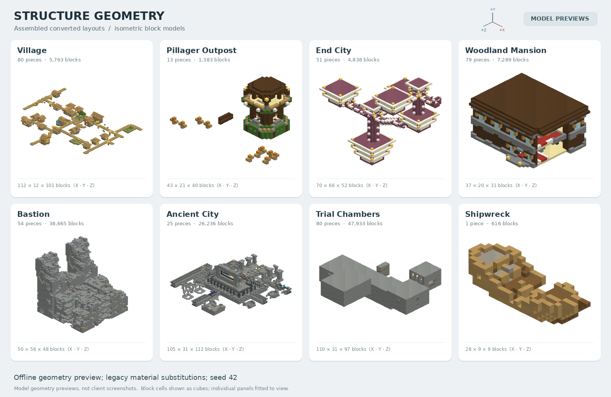

# MCP-Reborn 26.2 建筑移植

建筑资源已接入 MPMPESCore 的主世界、地狱、末地区块生成流程。旧地图已经填充的区块不会重建，新建筑出现在新填充的区块；手动放置命令会改写指定区域。

末地基础地形和城楼布局采用 26.2 源码实现，原有简化网格外岛不再使用；新增标准 `/locate` 与跨世界 `/tp`。升级方式、验证与已知限制见 [26.2 末地说明](docs/END_26_2.md) 和 [传送指令说明](docs/TELEPORT.md)。

## 资源范围

原始 ZIP SHA-256：`d99d07299bea85b70f9f695d85e7e30f804b4588942e3adffe854824d0f56706`。

转换器从 ZIP 内 `projects/mcp/build/mcp/extractServer/output.jar` 读取原版 NBT/JSON，不执行 Java。输出包含全部 **1,212 个模板、188 个拼图池、1,355 个战利品表**及原版 worldgen/processor 元数据。原始模板、方块实体和实体清单的摘要、源文件校验值见 `resources/structures/inventory.json` 和 `manifest.json`。

| 模板系列 | 数量 | 接入方式 |
| --- | ---: | --- |
| 村庄 | 483 | 平原、沙漠、热带草原、雪地、针叶林及僵尸变体；道路/房屋拼装 |
| 掠夺者前哨站 | 11 | 塔楼、营地及周围配件 |
| 末地城 | 20 | 房屋、塔楼、桥梁、可选末地船；末地外岛 |
| 林地府邸 | 73 | 两层紧凑府邸，原版房间、楼梯、外墙和屋顶模块 |
| 堡垒遗迹 | 167 | 原版拼图池有界拼装 |
| 远古城市 | 58 | 原版拼图池有界拼装 |
| 试炼密室 | 191 | 原版拼图池有界拼装 |
| 古迹废墟 | 84 | 原版拼图池有界拼装 |
| 海底废墟 | 48 | 单栋或建筑群 |
| 沉船 | 20 | 完整船与残骸变体 |
| 化石 / 下界化石 | 16 / 14 | 对应世界自然生成 |
| 废弃传送门 | 13 | 主世界和地狱自然生成 |
| 雪屋 | 3 | 地表、楼梯井和地下室组合 |
| spring / empty | 10 / 1 | 完整保留；可按模板路径手动放置；不额外自然生成 |

没有独立 NBT 模板的建筑通过 `LegacyStructures.php` 的有界程序化适配补充：沙漠神殿、丛林神庙、沼泽小屋、要塞、废弃矿井、下界要塞、海底神殿、埋藏的宝藏、末地中央喷泉、折跃门外观、沙漠水井和地牢。它们保留可识别建筑和房间/通道，**并非原 Java 完整递归生成算法**。

## 命令

需要 OP 或权限 `pocketmine.command.structure`。控制台命令不带开头的 `/`。

```text
/structure list
/structure locate village
/structure locate village 0 0
/structure place village 100 70 100 snowy
/structure place pillager_outpost 300 65 300
/structure place end_city 600 45 600 ship
/structure place woodland_mansion 900 65 900
/structure place village/plains/houses/plains_small_house_1 100 70 100
```

- 标准 `/locate [structure] <name> [x z]` 在玩家当前维度/位置搜索；控制台默认主世界出生点，可提供 x/z。`/structure locate` 的旧入口也保留。搜索使用最近距离证明；预算耗尽明确标记未完成。结果是自然生成的建筑锚点，已经生成过的旧区块不保证存在预测建筑。测试参考种子下的结果有独立枚举和实服生成验证；你自己的坐标取决于存档种子。
- `place` 的坐标是模板基准点，并非地表点；选择足够的高度余量。旧版合法建筑范围为 y=1..126；地下室会有负相对高度，过高或过低会直接拒绝。
- 玩家可省略坐标，使用当前位置。村庄 `variant` 支持 `plains`、`desert`、`savanna`、`snowy`、`taiga`，以及 `plains/zombie` 等。
- 完整模板路径见 `manifest.json`，1,212 个模板均可单独放置。
- 手动放置先异步生成缺少的地形，再逐区块写入，完成后给出统计。

## 配置与已有地图

`genisys.yml` 顶层：

```yaml
structures:
  enabled: true
  families:
    village: {enabled: true, spacing: 28}
    pillager_outpost: {enabled: true, spacing: 32}
    woodland_mansion: {enabled: true, spacing: 64}
    end_city: {enabled: true, spacing: 20}
    bastion: {enabled: true, spacing: 28}
    nether_fortress: {enabled: true, spacing: 28}
```

`spacing` 是候选区域边长（区块），其他适配系列允许 12..128。**26.2 末地城固定使用原版 20/11 候选区域与分隔，不接受 spacing 覆盖**。可以给自然生成系列设置 `enabled: false` 禁用；重启后生效。平坦和星界生成器不自动生成这些建筑。

其他系列按世界种子、系列和区域选择位置，检查根建筑地形与水面；仅写当前区块，跨区块部分在相邻区块生成时补齐。已经填充的邻居受保护，后续树木不会覆盖其建筑。村庄等大型适配建筑仍使用统一高度基准，远端房屋/道路可能存在贴地差异；未实现 Java 完整 terrain-matching/beard 算法。**末地已单独改为 26.2 原版基础地形和末地城候选/递归布局规则**；其材质、高度和装饰碰撞边界见最新末地说明。

升级前请备份自己的地图和玩家数据。已有区块不会被自动替换；要获得完整的新末地，可先保留旧末地目录，再通过配置指定另一个末地世界名。源码仓库不包含运行时存档或部署备份。

## 方块、容器和机制边界

- 所有 **1,520 个源方块状态**都映射到本核心已注册的 MCPE 方块 ID，包含四种朝向；未映射状态使转换失败。414 种名称中 253 种存在材质替代或状态细节损失，完整记录见 `resources/structures/mapping_report.json`。
- 深板岩、紫珀、铜、凝灰岩等采用旧版材质。台阶、楼梯、木材方向、门等保留可表示的朝向；水含方块、部分细分形状和新版方块行为不可表示。
- 沉船等 20 个模板的多套 palette 全部经过验证并保留在报告中，运行时固定采用 palette 0。
- 末地城叠加楼层按源规则忽略空气，防止清掉下层外墙。府邸采用紧凑两层布局，非原版随机三层府邸的完整算法。
- 箱子、发射器、熔炉、漏斗、花盆、告示牌、头颅等可表示的方块实体会转换，宝箱结构标记会还原。战利品的权重、数量及部分嵌套表有界适配，条件、附魔、药水函数和现代数据组件未完整实现。
- 不支持的战利品被跳过，部分材料有明确替代；不会把未知物品统一变成贵重物品。可用 `StructureTiles::itemMappingReport()` 查看运行时转换结果。241 个宝箱可达物品名中，有 78 个目前无法表示而省略。
- 源模板携带的旧版村民、僵尸村民、部分农场动物、铁傀儡和猫可转换为已有实体类；建筑拼装会跳过纯实体模板池，因而不会完整还原 Java 村庄人口生成。掠夺者、灾厄村民、Allay、猪灵、疣猪兽、骆驼等新实体和 AI 未移植。
- 前哨站、试炼密室、远古城市只提供建筑及可表示的容器。袭击、试炼刷怪笼、保险库、幽匿感测等机制未加入。末地中央喷泉/折跃门是建筑外观，未新增传送行为。末地船鞘翅位置用旧版物品展示框和钻石胸甲替代，没有飞行功能。
- 这些资源及元数据来源于用户提供的 Minecraft 归档；项目自身 LGPL 许可不会变更原始资源的来源和权利归属。

## 验证

已完成：

1. 全部 1,212 模板坐标、palette、四向映射、解码后方块实体/实体数据、源文件摘要及确定性转换检查。
2. 全项目 PHP 文件语法检查；27 类非空建筑布局写入真实旧版区块，覆盖负坐标、跨区块、地下室及合法高度。
3. 固定种子的主世界村庄、末地城及中央喷泉、地狱建筑落脚点与实际写入检查。
4. 府邸六个种子/四种旋转的合并几何检查，八个房间均能从入口经楼梯到达，屋顶及采样外墙闭合。
5. 独立运行服务端生成 **309 个区块、112 个方块实体、65 个箱子**，保存卸载重载后保留 **219 组有效战利品**，正常关服退出码 0。
6. 主服启动、定位命令、手动单模板放置及 RakNet UDP 探测通过。未进行真实 MCPE 客户端进服截图验证。

重复基础测试：

```bash
python3 tools/test_structure_resources.py
python3 tools/structure_import/test_import.py
./bin/php7/bin/php tools/test_structures.php
python3 tools/test_structure_server.py  # 独立临时世界，默认 UDP 19142，自动保存/重载/关服
python3 tools/import_vanilla_structures.py /path/to/MCP-Reborn-26.2.zip --check
python3 tools/render_structure_previews.py
```

离线预览根据实际放置顺序和方块数据渲染，仅用于检查几何与旧版替代材质，不是客户端截图：


